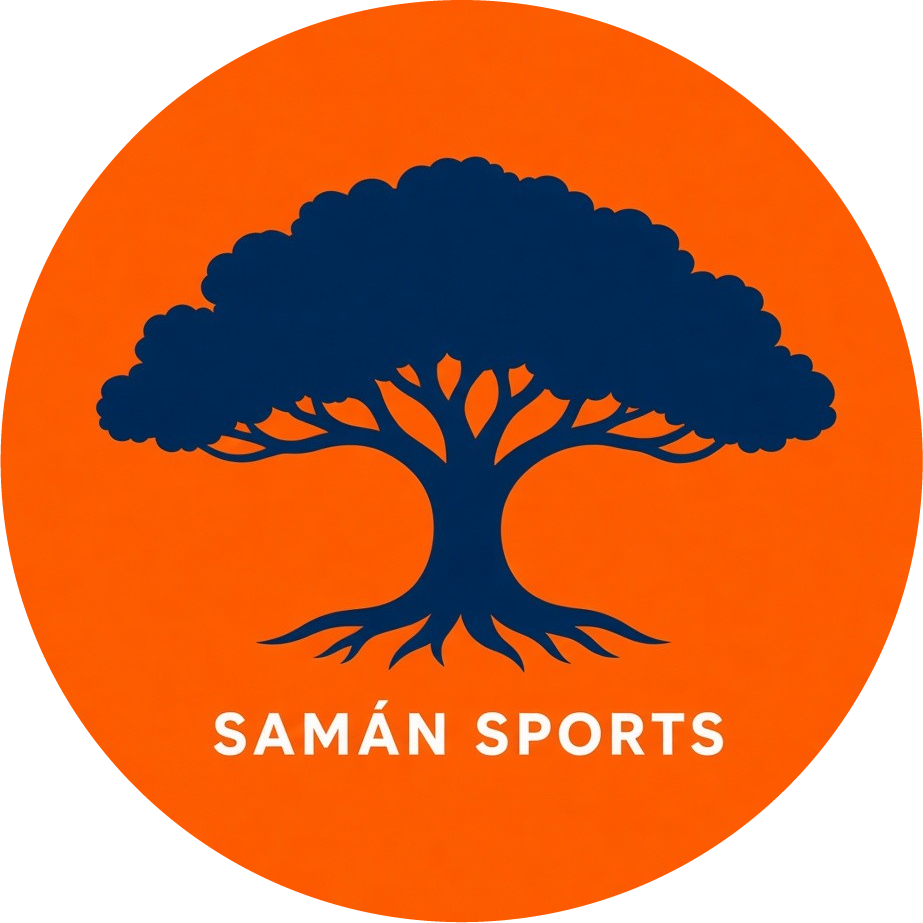

  

<h1 align="center">Saman Sports</h1>

  <b><a href="https://alechin1955.github.io/Saman_Sports/">👉 Ver la app en línea</a></b>

## Sobre la aplicación

**Saman Sports** es una aplicación web para gestionar las actividades deportivas de la Universidad Metropolitana (UNIMET). Reúne en un solo lugar a estudiantes, entrenadores y administradores: los estudiantes pueden explorar los deportes disponibles, inscribirse y dejar reseñas en la comunidad; los entrenadores gestionan sus grupos y la asistencia; y el administrador supervisa la plataforma.

Está desarrollada con **Flutter** (web) y **Firebase** (autenticación y base de datos Firestore), siguiendo la arquitectura **MVC**.

## Equipo

- Ariadna Lechin
- Andrés Benezra
- Diego Di Lima
- Gonzalo Maza
- Giancarlo Paolino

*Sistemas de Información — Universidad Metropolitana (UNIMET), 2026*
